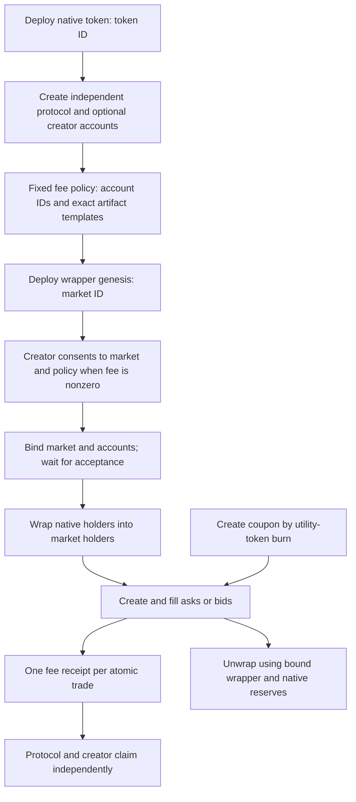

# Building the fee-market lifecycle

This cookbook uses `0.8.3-fee.3` on DEV TN10. Follow the
[installation guide](PUBLIC_INTEGRATION.md), [operation matrix](PUBLIC_OPERATION_MATRIX.md)
and [verification checklist](PUBLIC_INTEGRATION_CHECKLIST.md). The runner and
recipe generator are under development until their checklist gates are verified.

## Identities and flow



The token ID identifies native token lineage. The market ID identifies its wrapper
and trading lineage. A policy ID commits the immutable rates, account IDs and
artifact templates. Each account has a stable lineage and a changing outpoint.
Each receipt is a separate UTXO with protocol and creator entitlements, not a
shared balance that every trade consumes. Store the accepted transaction ID with
returned genesis/continuation hints; a bare P2SH address cannot reveal state.

## Build and submit one step

From `examples`, construct a JSON request using `fee-request`, then inspect it:

```sh
npm run --silent fee-request -- create-account account-config.json > request.json
npm run lifecycle -- --request request.json --rpc "$TN10_WRPC_URL" --evidence build.json
```

Example `account-config.json` (replace identities with your own):

```json
{
  "owner": { "walletAddress": "kaspatest:YOUR_ADDRESS", "kcc20Owner": "YOUR_64_HEX_SCHNORR_KEY" },
  "params": { "tokenId": "YOUR_64_HEX_TOKEN_ID", "principalSompi": "50000000" }
}
```

The first command only creates a request. The second queries the node and builds
an unsigned transaction. It cannot sign or broadcast without `--submit`.

A Node signer module exports `default` with `capabilities: { schnorr, ecdsa }`
and `async sign(unsignedTransactionJson, signInputs)`, returning transaction JSON
with raw input signatures for the supplied `signInputs` only. The adapter includes
funding inputs and covenant inputs that require a signature. It assembles
argument-only covenant witnesses locally without asking the wallet to sign them.
Keep keys in your host wallet; do not put them in request JSON. The signer
module is trusted local code. The runner verifies unchanged transaction intent,
assembles covenant witnesses, checks signed mass and rechecks live inputs.

```sh
npm run lifecycle -- --request request.json --rpc "$TN10_WRPC_URL" \
  --evidence submitted.json --signer /absolute/path/to/your-signer.ts \
  --max-debit-sompi 200000000 --submit
npm run lifecycle -- --evidence submitted.json --resume --rest "$TN10_REST_URL"
```

The example cap is 2 KAS, not a universal budget. Set it to your reviewed spend.
Never reuse an evidence filename: it records the signed transaction before
broadcast. If the response is lost, resume by its transaction ID instead of
creating another deployment. `--resume` checks acceptance without resubmitting;
it does not claim indexer parity. A false result may mean delayed REST publication.

Browser hosts use `frontend/lifecycle-wallet.ts` with their existing RPC and
wallet session. Show the built outputs, debit and fees before invoking `sign`.
Broadcast separately after `assertFresh`; never change outputs after signing.
The supplied browser adapter advertises Schnorr only. ECDSA requires an adapter
that implements the account signing requirements described in the authority guide.

## Setup and source handoff

1. Deploy the native token and wait for acceptance. Deployment alone does not
   establish verified token recognition: its P2SH script is revealed when spent.
   For a fixed-supply token, use a self-transfer from an accepted holder; for a
   mintable token, use the package's verification operation and inspect any mint
   payment. Wait for indexed verification before backend-assisted transfer or
   market setup. Do not treat a directory cache miss as a failed deployment.
2. Run `create-account` for the protocol recipient. Create a creator account only
   for a nonzero creator rate. An account starts under the signing wallet's control;
   do not silently substitute the deployer for the intended protocol recipient.
3. Build the policy with the package's `templateParts` and
   `prepareKcc20FeeMarketGenesis` helpers. Use creator basis points 0–500;
   creator account ID is all zeroes at rate 0. Record the selected ticket root.
4. `deploy-market-genesis` needs the token UTXO and both unbound account hints
   where applicable. Keep its `marketId`, `policyId` and `wrapperGenesisHint`.
5. For nonzero creator fees, use `kcc20CreatorFeeConsent` and the authenticated
   creator's signature for that exact market/policy. Funding changes that alter
   the market ID require fresh consent. Never treat an importer or supplied key
   as creator evidence.
6. Run `bind-market` with its required creator evidence, then `bind-account` for
   each account using the accepted creation hint and exact market/policy IDs.
   Check active state before wrapping. Platform recognition is a separate backend
   lifecycle process; local construction alone does not register a platform market.

Run `npm run fee-request` to list fee recipes. Each config has `owner`, `common`
and `params`. `common` carries `contractCanonicalTokenId`, `marketId`, `policyId`,
`feePolicy`, `priceScale`, `feeTicketId` and the matching `wrapperVersion`.
Operation-specific parameters override common values and are revalidated by the
builder. The parameter inventory is in `shared/fee-recipes.ts`; it does not replace
source/profile validation by the package.

## Trading and refunds

Wrap with `tokenUtxo`, `wrapperUtxo`, `tokenAmount` and `recipientOwner`. Unwrap
with `wrappedUtxo`, `wrapperUtxo` and the actual matching `reserveUtxo`. Use
`merge-holders` for compatible wrapped holders before operations requiring one.
Never use old `wrap`/order recipes on fee-market UTXOs.

Create asks with `holderUtxo`, `askAmount`, `askUnitPriceSompi`; bids with
`rootUtxo`, `bidAmount`, `bidUnitPriceSompi`. Cancellation consumes the current
owned ask or bid. Buy one ask with `askUtxo` and `fillAmount`; buy two with ordered
`asks` records. Seller sweeps use one `holderUtxo` and ordered `bids` records.
Keep the package's price-priority, fill-size, change and mass validation intact.

Each fill owes 1% protocol fee with a 0.5 KAS floor unless waived. A nonzero
creator rate has its own 0.5 KAS floor. Grouped trades sum each fill's fees into
one receipt. Ask buyers fund fees above the price; sellers filling bids receive
net proceeds. Compare every input principal with its continuation/refund; deposits
are actual UTXO values, not universally 0.5 KAS.

## Coupons and claims

Use `createFeeTicket` from `shared/recipes.ts` with the public root configuration,
current root state, utility-token holdings and quantity. It calls the package's
utility-burn operation. `transferFeeTicket` and `burnFeeTicket` retain their
existing flows. Root deployment and denomination changes are operator tasks.

Pass the live ticket in the trade parameters expected by the selected builder.
One eligible consumed ticket covers one taker's group in one market/transaction.
It does not waive creator fees. Check that the ticket disappears and its exact
principal is refunded. A failed build or rejected transaction does not consume it.

`claim` takes `party`, current `account`, 1–5 compatible `receipts` and the two
account IDs. The selected party receives its full share; the other party's share
continues in one receipt. Account principal continues unchanged; network fees
come from separate funding. Refresh all inputs after a competing claim succeeds.

`rotate-account` transfers control of all remaining entitlements of that account,
including older receipts. It does not change the other account or fee rates.
See [authority schemes](FEE_ACCOUNT_AUTHORITIES.md) and the
[supported recipient adapter](fee-recipient-wallet.md). Holder-reward accounting
and arbitrary recipient covenants are outside this release.

## Reveal and discovery after deployment

Generate a verification request using the published helper:

```sh
npm run --silent reveal-request -- reveal-config.json > reveal-request.json
```

The config has `owner` (the same wallet as deployment) and `token`, containing
`covenantId`, `activeTokenUtxo`, `decimals`, `ticker` and `tokenName`. Supply
`deployReceipt` and `mintPolicy` when required by the token's mint authority.
`activeTokenUtxo` must include the accepted outpoint, address, KAS amount and
complete decoded state. Obtain it from your deployment continuation data or
`GET /trading/covenants/{covenantId}/utxos`, then revalidate it against the node.
That public route returns `{ covenantId, utxos }`, without a network field.
The standalone transfer example accepts it, verifies a synced TN10 node and
checks each selected input against the live node. Custom providers can also
return the explicit `{ network, utxos }` envelope.

Build and inspect this request with `lifecycle`; signing and submission require
`--submit`, a host signer and an explicit debit cap. For fixed-supply tokens an
ordinary first transfer also reveals the script, so do not submit a second
verification transaction if an accepted first spend has already verified it.

Check `GET /trading/tokens/{covenantId}/creator-fee-evidence` for the native token's
indexed recognition. A 404 before verification is a pending discovery condition,
not proof the deployment failed. An unavailable creator authority must never be
interpreted as permission to enable creator fees. Indexer users can inspect
`GET /covenants/{id}?limit=0` for `claimVerified` and `classificationStatus`.
Retain accepted transaction IDs while waiting; never redeploy on a read timeout.

The PUBDOC1 funded example became verified at its first self-transfer. Its
verification timestamp matches that transaction's indexed block time. A later
explicit verification transaction was redundant. The original backend transfer
request ran before that first spend.

For creator consent, run `npm run --silent creator-consent -- --config bind-config.json`
to inspect the package-generated message. Add `--sign --signer /path/to/host.mjs`
only after reviewing the exact market, fee policy and recipient. The trusted host
module exports `signMessage(message)`; the resulting config contains public
consent, never a private key. Feed it to `fee-request bind-market`. If the market
ID changes, generate and sign new consent.

Generate native transfer requests from a public snapshot with
`KASPA_WRPC_URL=wss://your-node npm run --silent transfer-request -- transfer-config.json`.
The config uses network, stateUrl, wallet, covenantId, decimals, recipientOwner
and tokenAmount as documented by LiveTransferConfig. Pass the resulting request
to lifecycle for explicit signing and submission. `recipe NAME args.json --engine-input`
also converts existing helper recipes into lifecycle requests; the default recipe
output remains the wallet operation envelope.
