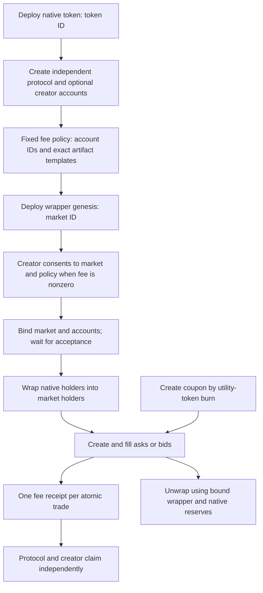

# Fee-market lifecycle status

This document describes the fee-market lifecycle and its current public-integration
boundary on DEV TN10. It is not a command cookbook.

## Availability in this checkout

The exact checkout for this guide does not ship a public lifecycle runner or its
source adapters. The following surfaces are unavailable and must not be treated
as runnable:

| Intended surface | Status |
| --- | --- |
| `fee-request`, `deploy-request`, `reveal-request`, `transfer-request` | No example scripts are shipped. |
| `lifecycle` build, sign, submit and resume flow | No example script is shipped. |
| `frontend/lifecycle-wallet.ts` | No browser adapter is shipped. |

The supported example scripts are listed in [example setup](../examples/README.md).
They include offline construction, browser construction, recipes and a fee quote,
but do not provide an end-to-end fee-market lifecycle journey. Package builders
and their tests do not substitute for a public source, signer and submission
adapter.

## Lifecycle model

The token ID identifies native token lineage. The market ID identifies its wrapper
and trading lineage. A policy ID commits the immutable rates, account IDs and
artifact templates. Each account has a stable lineage and a changing outpoint.
Each receipt is a separate UTXO with protocol and creator entitlements, not a
shared balance that every trade consumes. Store accepted transaction IDs with
returned genesis and continuation hints; a bare P2SH address cannot reveal state.

## Requirements for a future public integration

A future runner or browser adapter must supply all of the following before this
lifecycle can be presented as a copy-and-run public flow:

1. Discover decoded state, then revalidate every selected outpoint, script,
   ownership and value against fresh node UTXOs.
2. Build each operation with the matching package helper and inspect the unsigned
   transaction, required signing inputs, covenant hints and metadata.
3. Keep wallet keys in the host wallet. The host must assemble the required
   covenant witnesses, enforce an explicit spend limit, verify signed mass and
   recheck live inputs before broadcast.
4. Show outputs, debit and fees before signing. Do not change outputs after a
   wallet has approved them.
5. Record the transaction ID and separately check chain acceptance and indexed
   settlement. A broadcast response or HTTP success does not establish canonical
   acceptance.
6. Rebuild from fresh inputs after a conflict. A resume check must never submit
   a second transaction.

For a fixed-supply native token, an accepted first spend can reveal its script.
Wait for indexed recognition before relying on backend-assisted transfer or market
setup. A directory cache miss does not prove that a deployment failed. Nonzero
creator fees require creator consent for the exact market and policy; a changed
market ID requires new consent.

Use the [operation matrix](PUBLIC_OPERATION_MATRIX.md) to distinguish package
builder keys from public backend capabilities. Use the
[wallet-provider guide](PUBLIC_WALLET_PROVIDER.md) for the supported balance and
native-transfer API surface. Existing generic recipes target the older helper
family and are not interchangeable with `kcc20fee.*` market operations.

## Fees, coupons and claims

Each trade receipt holds protocol and, where configured, creator entitlements.
Claims must preserve the other party's entitlement and the account principal.
A FeeTicket is consumed only by the selected builder's eligible trade path; it
does not waive creator fees. Root deployment and denomination changes are
operator actions.

These are protocol constraints, not instructions for a shipped runner. A public
implementation must validate current account, receipt, market and policy state
at construction time and must not use an older order or wrapper recipe for a
fee-market UTXO.

## Historical evidence boundary

The [lifecycle](evidence/public-lifecycle-20261111.json) and
[creator lifecycle](evidence/public-creator-lifecycle-20261111.json) files are
historical execution records from an unpublished working tree. They cannot be
reproduced from this exact checkout because the runner and adapters are absent.
They do not verify a released public example or make any unavailable command
runnable.

A complete public lifecycle example remains a follow-up. It needs the runner,
Node and browser adapters, live-source tests, explicit signer and submission
controls, and funded TN10 evidence tied to the shipped source.
